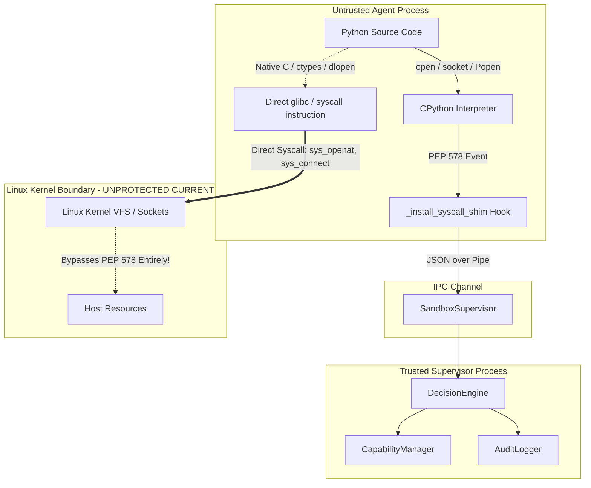

# CapLLM-Kernel: Systems Architecture & Security Implementation Audit

**Author:** Senior Linux Security Engineer & Python Systems Developer  
**Date:** October 12, 2026  
**Repository:** [https://github.com/aniishkumar/capLLM](https://github.com/aniishkumar/capLLM)  
**Target Systems:** Linux Kernel (x86_64 / aarch64), CPython 3.10+, POSIX Container Runtimes  

---

## 1. Executive Summary & Assessment

CapLLM-Kernel is conceptualized as a capability-based security reference monitor for multi-tenant LLM agent workloads. The research proposal outlines five core objectives:
1. **Capability Space Manager**: Decentralized authority model utilizing cryptographically signed tokens.
2. **Hybrid System-Call Interception & Enforcement**: Dual-path mediation for low-latency common operations and deep-inspection security mediation.
3. **Dynamic Capability Revocation & Tamper-Evident Auditing**: Sub-millisecond revocation and mathematically verifiable hash-chained audit trails.
4. **Isolated Linux Container Workloads**: Hard boundary isolation with namespaces, cgroups, and filesystem sandboxing.
5. **Security Evaluation & Reproducible Measurements**: Automated benchmarks assessing latency distributions, overhead, and threat scenarios.

### Critical Audit Findings
* **Architectural Schism [Resolved in Stage 1 / Historical Baseline]**: Prior to Stage 1, the codebase contained two parallel, incompatible implementations (`capability.py` vs `capability_space.py`). In Stage 1 and Stage 1.1, these were harmonized: `capllm.core.capability` is the canonical implementation, and `capllm.core.capability_space.TokenAuthority` was refactored into a backwards-compatible adapter translating legacy calls (including positional arguments and PID binding) to `CapabilityManager`.
* **Interception Mechanism Reality**: Syscall mediation is currently **simulated at the Python runtime level using CPython PEP 578 audit hooks** (`sys.addaudithook`) in live supervisor execution, and **in-process synthetic evaluation** in benchmarks. **Zero real Linux kernel system calls are trapped via kernel primitives (`seccomp-bpf` / `SECCOMP_RET_USER_NOTIF`).** Native C/Rust extensions, `ctypes`, or child binaries spawned directly can bypass Python audit hooks entirely.
* **Missing Container Isolation**: Workload isolation currently relies on `os.chdir(workspace)` and OS child processes (`multiprocessing.Process`). No Linux namespaces (`CLONE_NEWPID`, `CLONE_NEWNS`, `CLONE_NEWNET`), cgroups (v2), or `pivot_root`/chroot containment exist. The `cgroup_id` attribute is an unverified advisory integer.
* **Platform Limitations**: The current implementation runs on Windows/CPython with standard packaging definitions (`pyproject.toml` added in Stage 1). Filesystem symlink escape testing fails on Windows unless elevated privileges or Developer Mode are enabled.

---

## 2. Repository Entry Points, Class Map & Dependencies

### 2.1 Dependencies
* **External Dependencies**: **None**. The codebase strictly depends on the Python standard library (`hashlib`, `hmac`, `json`, `os`, `secrets`, `threading`, `time`, `uuid`, `dataclasses`, `multiprocessing`, `socket`, `subprocess`, `tempfile`, `unittest`).
* **Packaging Infrastructure [Added in Stage 1]**: Standard packaging defined in `pyproject.toml` supporting PEP 517/621 builds and test suite discovery.

### 2.2 Entry Points
| Entry Point | Path | Target Invocation | Primary Classes & Flow |
| :--- | :--- | :--- | :--- |
| **End-to-End Demo** | `run_demo.py` | `python run_demo.py` | `EvaluationSuite.run_all()`: Orchestrates S1-S4 live multiprocess attack scenarios, micro-benchmarks, and cryptographic self-tests. |
| **Synthetic Benchmark** | `run_benchmarks.py` | `python run_benchmarks.py` | `BenchmarkHarness.print_benchmark_report()`: Evaluates 400 in-memory synthetic operations against `TokenAuthority`. |
| **Unit Test Suite** | `tests/test_capability_space.py` | `python -m unittest discover tests` | Imports and executes `TestCapabilitySpace` from `capllm.core.capability_space`. |
| **Module Standalone** | `capllm/core/capability_space.py` | `python -m capllm.core.capability_space` | Runs embedded `TestCapabilitySpace(unittest.TestCase)`. |
| **Harness Standalone** | `capllm/benchmarks/harness.py` | `python -m capllm.benchmarks.harness` | Direct execution of `BenchmarkHarness`. |

### 2.3 Class Map & Component Architecture
```text
capllm/
├── core/
│   ├── capability.py (Branch A)
│   │   ├── CapabilityToken (frozen dataclass: token_id: str, paths: MappingProxyType, frozenset)
│   │   ├── TokenValidation (valid: bool, reason: str)
│   │   └── CapabilityManager (HMAC-SHA256 signing, PID binding, cache, revocation set)
│   ├── capability_space.py (Branch B - Monolithic Duplicate)
│   │   ├── PathPermission (path: str, modes: str)
│   │   ├── CapabilityToken (dataclass: token_id: UUID, cgroup_id: int, List[PathPermission])
│   │   ├── AuditAction (Enum: TOKEN_ISSUED, TOKEN_REVOKED, ACCESS_ALLOWED, ACCESS_DENIED)
│   │   ├── AuditEntry (dataclass: sequence, hash chain linking, verify_hash())
│   │   ├── TokenAuthority (Standalone manager + embedded audit log + permission cache)
│   │   └── TestCapabilitySpace (Embedded unittest suite)
│   └── audit.py (Branch A)
│       ├── EventType (Enum: TOKEN_ISSUED, SYSCALL_INTERCEPTED, ACCESS_*, PROCESS_TERMINATED)
│       ├── Verdict (Enum: ALLOW, BLOCK, PENDING)
│       ├── AuditEvent (frozen dataclass: SHA-256 canonical hash chaining)
│       └── AuditLogger (Thread-safe append-only memory & JSONL ledger, verify_chain())
├── runtime/
│   └── interceptor.py (Branch A)
│       ├── MediationPath (FAST, SLOW), EnforcementMode (KILL, ERRNO), RunOutcome
│       ├── SyscallRequest, Decision (verdict, path, latency_ns)
│       ├── DecisionEngine (Gate 0 validity, Gate 1 PID bind, fast cache, deep validator)
│       ├── _install_syscall_shim (PEP 578 sys.addaudithook in untrusted child)
│       └── SandboxSupervisor (multiprocessing spawn, Pipe IPC, KILL enforcement)
└── benchmarks/
    ├── eval_suite.py (Branch A Driver)
    │   ├── task_* (benign, traversal, execve, exfiltration, revocation tasks)
    │   └── EvaluationSuite (S1-S4 scenarios, overhead timing, cryptographic self-tests)
    └── harness.py (Branch B Driver)
        ├── ThreatScenario, TestCase, TestEvaluation, ConfusionStats
        ├── SyntheticWorkloadGenerator (synthetic traversal, process, net, revoke cases)
        └── BenchmarkHarness (synthetic in-memory execution against TokenAuthority)
```

---

## 3. Detailed Architectural Comparison: `capability.py` vs. `capability_space.py` (Pre-Stage-1 Historical Baseline)

> [!NOTE]
> **Harmonization Status**: The divergence detailed below was the historical state prior to Stage 1. As of Stage 1 and Stage 1.1, `capllm.core.capability` has been established as the canonical capability implementation, and `capllm.core.capability_space.TokenAuthority` serves as a backward-compatible adapter delegating to `CapabilityManager`.

A critical defect in the original repository design was the coexistence of two divergent capability representations:

| Architectural Dimension | `capllm/core/capability.py` (Runtime Supervisor Branch) | `capllm/core/capability_space.py` (Harness & Test Branch) | Divergence Impact |
| :--- | :--- | :--- | :--- |
| **Token Representation** | `CapabilityToken` (frozen dataclass, `token_id: str`, immutable `MappingProxyType` and `frozenset`). | `CapabilityToken` (mutable dataclass, `token_id: uuid.UUID`, `cgroup_id: int`, `List[PathPermission]`). | **Incompatible types.** Passing one token to the other manager triggers attribute and serialization errors. |
| **Path Authority Model** | Direct dictionary mapping canonical path prefix to `FrozenSet[str]` (`{"read", "write", "exec"}`). | Wrapper dataclass `PathPermission` with mode string (`'r'`, `'w'`, `'rw'`, `'rwx'`). | Inconsistent policy declaration syntax across benchmarks. |
| **Token Identifier** | String UUID (`str(uuid.uuid4())`). | Native `uuid.UUID` object. | Serialization and hashing payload discrepancies. |
| **Process Binding** | Optional PID (`pid: Optional[int]`), dynamically bound via `bind_pid()` after `proc.start()`. | Bound at mint time (`pid: int`, `cgroup_id: int`). | Branch B cannot bind real processes spawned asynchronously. |
| **Audit Logging Architecture** | Decoupled; delegates to `capllm.core.audit.AuditLogger` with explicit events (`SYSCALL_INTERCEPTED`, `PENDING`). | Tight coupling; `TokenAuthority` maintains its own `_audit_log: List[AuditEntry]`. | Two divergent audit event schemas and chain verifiers. |
| **Path Canonicalization** | `normalize_path(path, cwd)`: calls `os.path.normcase(os.path.realpath(...))`. | `canonicalize_path(target_path, cwd)`: calls `os.path.normcase(os.path.realpath(os.path.abspath(...)))`. | Redundant implementations of identical POSIX/Windows normalization. |
| **Subpath Validation** | `path_is_within(candidate, prefix)`: verifies `os.path.commonpath([candidate, prefix]) == prefix`. | `is_subpath(candidate, allowed_prefix)`: identical `os.path.commonpath` comparison. | Code duplication. |
| **Consumers** | `capllm.runtime.interceptor`, `capllm.benchmarks.eval_suite`, `run_demo.py`. | `capllm.benchmarks.harness`, `tests/test_capability_space.py`, `run_benchmarks.py`. | The unit tests in `tests/` do not test the actual runtime supervisor! |

---

## 4. Execution Trace Analysis

### 4.1 Trace: `run_demo.py` (Live Multiprocess Scenario Evaluation)
1. **Bootstrap**: `main()` configures root logging and initializes `EvaluationSuite(audit_log_path="capllm_audit.jsonl")`.
2. **Environment Setup**: `prepare_environment()` creates temporary directory hierarchies for `tenant_a`, `tenant_b`, and `capllm_bench`. Writes mock target `/data/secret.txt`. Binds ephemeral TCP listener on `127.0.0.1` as mock tool API.
3. **Scenario S1 (Benign Execution)**:
   - `_token_tenant_a()` issues HMAC-signed token granting access to `tenant_a/workspace` and `127.0.0.1:<api_port>`.
   - `SandboxSupervisor.run_agent()` spawns a clean child via `multiprocessing.get_context("spawn")`.
   - Child calls `_sandbox_entrypoint()` -> `os.chdir(workspace)` -> installs PEP 578 hook `_install_syscall_shim()`.
   - Child executes `task_benign_tenant`: file writes/reads trigger `sys.addaudithook("open")`.
   - The shim packages a `SyscallRequest` dictionary and transmits it across `multiprocessing.Pipe`.
   - Supervisor intercepts in `_mediate()`, runs `DecisionEngine.decide()`.
   - Gate 0 (validity), Gate 1 (PID binding), and Fast Path (`cached_path_decision`) pass.
   - Supervisor replies `{"verdict": "ALLOW"}`. Child unblocks and completes.
4. **Scenario S2 (Path Traversal & Exfiltration)**:
   - Evaluates attacks S2a (`/etc/passwd`), S2b (`../../tenant_a`), S2c (absolute cross-tenant path), S2d (symlink escape), and S2e (unauthorized IP `203.0.113.66:4444`).
   - S2a-c and S2e trigger `DecisionEngine._slow_path()`: path classification flags traversal or unlisted destination.
   - Engine issues synchronous `SYSCALL_INTERCEPTED` with `Verdict.PENDING`, followed by `ACCESS_DENIED` with `Verdict.BLOCK`.
   - In `EnforcementMode.KILL`, supervisor executes `proc.kill()`, terminates child, and logs `PROCESS_TERMINATED`.
   - *Anomaly*: S2d fails with Windows error 1314 (missing privilege) and is recorded as skipped.
5. **Scenario S3 (Arbitrary Code Execution)**:
   - Agent B attempts `task_reverse_shell` (`/dev/tcp`), `task_download_and_execute` (`curl | sh`), and `task_unpermitted_binary`.
   - Ingested via Python audit hooks on `subprocess.Popen` / `os.system`.
   - In `_validate_exec()`, regular expressions flag reverse shells; unpermitted paths fail path capability checks. Process is killed.
6. **Scenario S4 (Dynamic Revocation & Expiry)**:
   - S4a: Background thread executes `caps.revoke_token()` after 4 operations. Operation 5 is denied at Gate 0 and child killed.
   - S4b: Short TTL (2s) expires during agent sleep. Subsequent call is rejected as expired and child killed.
7. **Overhead & Cryptographic Self-Tests**:
   - Compares unmediated baseline vs. mediated file I/O operations.
   - Inverts tokens (forgery check) and edits/deletes entries in the SHA-256 audit chain to confirm mathematical tamper detection.

### 4.2 Trace: `run_benchmarks.py` (Synthetic Policy Benchmark)
1. **Bootstrap**: `main()` instantiates `BenchmarkHarness(cases_per_scenario=100)`.
2. **Setup**: Instantiates `TokenAuthority` from `capability_space.py` and pre-allocates tokens for `tenant_alpha`, `tenant_beta`, `tenant_gamma`, and `tenant_delta`.
3. **Execution**:
   - `SyntheticWorkloadGenerator.generate_suite()` generates 400 `TestCase` instances (100 per category: `FILE_TRAVERSAL`, `PROCESS_SPAWN`, `NETWORK_EXFILTRATION`, `REVOKED_ACCESS`).
   - For each case, `BenchmarkHarness.run_enforcement_evaluation()` calls `auth.check_permission(tenant_id, pid, op, resource, mode)` directly in-memory.
   - **No processes are spawned, no pipes are used, and no system calls are intercepted.**
4. **Memory Profiling**: Iterates across tenant scales (10, 50, 200, 1000) using `deep_getsizeof` on internal dictionary tables.
5. **Report**: Formats terminal Markdown tables detailing confusion matrix and decision latency.

---

## 5. Interception Analysis: Intercepted vs. Simulated / Checked in Python

A foundational requirement of a systems security audit is distinguishing real mediation from simulated policy checks.



### 5.1 Actually Intercepted Operations (Via CPython PEP 578 Hooks)
When agent tasks execute inside CPython, the following standard library operations raise audit events that are suspended and sent to the supervisor:
* `open` / file open flags -> mapped to simulated `openat` (read or write perm).
* `os.listdir` / `os.scandir` -> mapped to simulated `getdents64` (read perm).
* `os.mkdir` -> mapped to simulated `mkdirat` (write perm).
* `os.remove` / `os.rmdir` -> mapped to simulated `unlinkat` (write perm).
* `subprocess.Popen` / `os.system` / `os.exec*` / `os.spawn*` / `os.startfile` -> mapped to simulated `execve` (exec perm).
* `socket.connect` / `socket.bind` -> mapped to simulated `connect` / `bind`.
* `os.kill` -> mapped to simulated `kill`.
* `ctypes.dlopen` -> mapped to simulated `dlopen`.

### 5.2 Simulated / Python-Checked Operations (No Kernel Enforcement)
* **All operations in `run_benchmarks.py`**: Synthetic tests do not execute operations; they pass strings to `check_permission()`.
* **Direct Native System Calls**: Any executable binary, compiled C/Rust extension, or inline assembly using `syscall` (e.g., `SYS_openat`, `SYS_connect`) completely bypasses PEP 578 audit hooks.
* **Non-Python Executables**: If an agent spawns an authorized binary (e.g., `worker_tool`), any syscalls executed by that child binary are completely unmonitored.
* **Process Confinement**: `os.chdir()` is not a sandbox. Calling `open("/etc/passwd")` is checked only because Python raises `"open"`. If a sub-process calls `openat(AT_FDCWD, ...)`, no chroot or mount namespace prevents access.

---

## 6. Target Linux Kernel Features, Privileges & Build Requirements

To elevate CapLLM-Kernel from a Python research prototype to a true kernel-enforced system, the following Linux kernel primitives, privileges, and tooling are required:

### 6.1 Linux Kernel Features
1. **`seccomp-bpf` with `SECCOMP_RET_USER_NOTIF`**:
   - **Mechanism**: The supervisor sets up a seccomp filter on the agent process with `SECCOMP_FILTER_FLAG_NEW_LISTENER`, obtaining a notification file descriptor (`notif_fd`).
   - **Interception**: Kernel traps target syscalls (`openat`, `openat2`, `execve`, `execveat`, `connect`, `bind`, `unlinkat`, `mkdirat`, `clone3`) before execution.
   - **Inspection**: Supervisor issues `ioctl(notif_fd, SECCOMP_IOCTL_NOTIF_RECV, &req)`. Reads memory arguments (paths, sockaddr) via `process_vm_readv()` to avoid TOCTOU races.
   - **Enforcement**: Supervisor returns `SECCOMP_IOCTL_NOTIF_SEND` with `flags = 0` and `val = 0` (ALLOW), or `error = -EACCES` / kills process with `pidfd_send_signal()`.
2. **Linux Namespaces**:
   - `CLONE_NEWPID`: Process isolation preventing visibility of host processes.
   - `CLONE_NEWNS` (Mount): Private mount namespace with `pivot_root` into a minimal, read-only rootfs + private tmpfs workspace.
   - `CLONE_NEWNET`: Network isolation; unprivileged agents have only a loopback interface or a veth pair governed by eBPF/tc.
   - `CLONE_NEWUSER`: Rootless execution mapping container UID/GID to unprivileged host users.
   - `CLONE_NEWIPC` & `CLONE_NEWUTS`: Hostname and IPC isolation.
3. **Control Groups v2 (`cgroups v2`)**:
   - Real confinement for `cgroup_id`: attach to `/sys/fs/cgroup/capllm/<tenant_id>/<agent_id>/cgroup.procs`.
   - Resource limits: `memory.max`, `pids.max` (fork-bomb prevention), `cpu.max`.
4. **Filesystem Sandboxing**:
   - `openat2` with `RESOLVE_BENEATH` and `RESOLVE_NO_SYMLINKS` to prevent traversal at the kernel VFS layer.

### 6.2 Required System Privileges
* **With Root / Daemon Privilege**: `CAP_SYS_ADMIN` (namespaces, mounts, seccomp listeners), `CAP_NET_ADMIN` (network setup).
* **Rootless / Unprivileged Mode**: `PR_SET_NO_NEW_PRIVS` allows unprivileged users to attach seccomp filters and configure user namespaces (`CLONE_NEWUSER`).

### 6.3 Build Tools & System Libraries
* **Build Toolchain**: GCC or Clang (C11), GNU Make / CMake, or Rust (MSRV 1.75+) with `cargo`.
* **System Libraries**:
  - `libseccomp` (`libseccomp-dev`, version >= 2.5.0).
  - `libcap` (`libcap-dev`) for POSIX capability manipulation.
* **Python Interoperability**:
  - `cffi` or Rust `pyo3` bindings to compile the low-level seccomp supervisor loop into an importable extension module (`capllm._seccomp`).

---

## 7. Research Proposal Objective Mapping

| Proposal Objective | Existing Code Base | Missing Implementations | Required Verification Evidence | Status |
| :--- | :--- | :--- | :--- | :--- |
| **1. Capability Space Manager** | `capllm/core/capability.py` (`CapabilityManager`), `capllm/core/capability_space.py` (`TokenAuthority`). | Unified data model, persistent token authority, integration with cgroups v2 hierarchy. | Type-safe tests validating uniform token issuance across runtime and benchmarks. | **Partially Implemented** |
| **2. Hybrid Syscall Interception & Enforcement** | `capllm/runtime/interceptor.py` (`DecisionEngine`, PEP 578 shim, dual-path cache). | Real kernel interception (`SECCOMP_RET_USER_NOTIF`), BPF filter generator, `process_vm_readv` memory reader. | Seccomp filter trapping a compiled C binary calling raw `openat` and `connect`. | **Partially Implemented (Python Only)** |
| **3. Dynamic Revocation & Tamper-Evident Auditing** | `capllm/core/audit.py` (`AuditLogger`), `capability.py` (thread-safe revocation, Gate 0). | External hash anchoring (WORM storage / RFC 6962 transparency log / TPM quote). | Benchmark showing zero-latency window on multi-threaded revocation + cryptographic verification. | **Implemented (In-Memory & JSONL)** |
| **4. Isolated Linux Container Workloads** | Stand-in `os.chdir(workspace)` and child processes in `interceptor.py`. Dummy `cgroup_id` in `capability_space.py`. | Linux namespaces (`user`, `pid`, `mount`, `net`), rootfs creation, `pivot_root`, cgroups v2 controller. | `/proc/self/status` and `/proc/self/ns/*` inspection demonstrating isolated namespaces and memory quotas. | **Unimplemented** |
| **5. Security Evaluation & Reproducible Measurements** | `eval_suite.py` (S1-S4 scenarios), `harness.py` (synthetic confusion matrix), `run_demo.py`. | Automated Linux test runner, CI workflow, container workload benchmarks, real syscall latency profiling. | Automated execution of full test suite and harness inside a Linux container environment. | **Partially Implemented** |

---

## 8. Gap Analysis & Defects

### 8.1 Duplications (Pre-Stage-1 Historical Baseline)
1. **`CapabilityToken` [Resolved in Stage 1]**: Unified under frozen `CapabilityToken` in `capllm.core.capability.py`. `capllm.core.capability_space` re-exports it.
2. **Audit Logging [Resolved in Stage 1]**: Unified under `AuditLogger` / `AuditEvent` in `capllm.core.audit.py`. `capllm.core.capability_space` re-exports compatibility types.
3. **Path Handling [Resolved in Stage 1]**: Redundant path functions in `capability_space.py` replaced with delegates to `normalize_path` and `path_is_within`.
4. **Benchmark Runners [Harmonized in Stage 1 & 1.1]**: `BenchmarkHarness` now delegates policy evaluation directly to `TokenAuthority` adapter and `CapabilityManager`.

### 8.2 Missing Integrations & Gaps
1. **Packaging [Resolved in Stage 1]**: Added standard `pyproject.toml` supporting PEP 517/621 builds and test discovery.
2. **Unit Test Coverage [Resolved in Stage 1 & 1.1]**: Comprehensive unit tests added across `tests/test_capability.py`, `tests/test_audit.py`, `tests/test_interceptor.py`, and `tests/test_capability_space.py` (30 test cases total).
3. **Unverified Windows Execution**: Scenario S2d (`symlink_escape`) requires elevated Windows privileges (Developer Mode / Administrator) to create filesystem symlinks (`WinError 1314`). On Windows without privileges, this scenario is safely detected and recorded as skipped.

---

## 9. Prioritized Multi-Stage Implementation Plan

### Stage 1: Core Architecture Harmonization & Unified Capability Space (Completed)
* **Goal**: Eliminate architectural duplication, unify `CapabilityToken`, establish standard packaging, and maintain legacy API compatibility.
* **Dependencies**: None.
* **Work Items**:
  1. Unify `CapabilityToken` into `capllm/core/capability.py` supporting path permissions, syscall sets, endpoint tuples, and cgroup identifiers. [Completed]
  2. Implement backwards-compatible `TokenAuthority` adapter in `capllm/core/capability_space.py` supporting legacy positional calls and PID binding. [Completed in Stage 1.1]
  3. Create `pyproject.toml` specifying Python 3.10+ build standards and test dependencies. [Completed]
  4. Expand `tests/` with dedicated unit test suites for `CapabilityManager`, `AuditLogger`, `DecisionEngine`, and `TokenAuthority`. [Completed in Stage 1.1]
* **Acceptance Criteria**: All unit tests pass; `run_demo.py` and `run_benchmarks.py` utilize the canonical capability model without duplicate implementations.

### Stage 2: Linux Workload Isolation (Namespaces & cgroups v2) (Completed)
* **Goal**: Provide real container boundaries for agent child processes on Linux.
* **Dependencies**: Stage 1, Linux environment.
* **Work Items**:
  1. Implement a Linux sandbox runner (`capllm/runtime/sandbox_linux.py`) using `unshare(2)` / `clone(2)` for user, PID, mount, and network namespaces. [Completed]
  2. Implement filesystem containment: private workspace mounting with private propagation (`MS_REC | MS_PRIVATE`), host sentinel invisibility, and cross-tenant barrier. [Completed]
  3. Implement cgroups v2 management: dedicated tenant slices, PID attachment to `cgroup.procs`, configurable `memory.max` and `pids.max` enforcement, and reliable teardown. [Completed]
  4. Provide honest prerequisite probe and fallback for non-Linux host development. [Completed]
* **Acceptance Criteria**: Running an agent process on Linux confirms isolation via unshared namespace inodes and constrained cgroup limits; on non-Linux hosts, returns explicit unsupported fallback.

### Stage 3: Real Linux Kernel Syscall Interception (`seccomp_user_notif`)
* **Goal**: Replace interpreter-level PEP 578 hooks with kernel-level seccomp notification mediation.
* **Dependencies**: Stage 2, `libseccomp` / C/Rust FFI.
* **Work Items**:
  1. Build a BPF filter generator in C/Rust or via Python `cffi` installing `SECCOMP_RET_USER_NOTIF` on sensitive syscalls (`openat`, `execve`, `connect`).
  2. Implement the supervisor notification loop listening on the seccomp listener file descriptor.
  3. Implement memory inspection: use `process_vm_readv` to read target strings directly from child memory buffers.
  4. Connect the seccomp listener directly to the existing `DecisionEngine` fast and slow paths.
* **Acceptance Criteria**: A compiled C binary attempting unauthorized `openat` or `connect` inside the sandbox is blocked and terminated, regardless of Python hooks.

### Stage 4: Cryptographic Anchoring & External Audit Verification
* **Goal**: Provide mathematical non-repudiation against log alteration.
* **Dependencies**: Stage 1.
* **Work Items**:
  1. Implement an external hash-anchor provider (e.g., periodic signed head checkpoint or file-backed append ledger).
  2. Add cryptographic verification CLI command (`python -m capllm.audit verify <log_path>`).
* **Acceptance Criteria**: Verifier mathematically validates chain continuity and detects any modification to past records.

### Stage 5: Reproducible End-to-End Evaluation & Benchmarks
* **Goal**: Validate performance and security under production container conditions.
* **Dependencies**: Stages 1 through 4.
* **Work Items**:
  1. Build a Docker/containerized evaluation testbed (`Dockerfile`) containing the Linux kernel test environment.
  2. Update `harness.py` to run live syscall benchmarks measuring real `seccomp_user_notif` latency overhead alongside PEP 578 baseline.
  3. Automate full benchmark regression in GitHub Actions CI running on Linux runners.
* **Acceptance Criteria**: Full evaluation suite executes autonomously on Linux, producing verified latency distributions and 100% detection accuracy.

---

## 10. Stage 1 & Stage 1.1 Completion Addendum (October 12, 2026)

### 10.1 Completed Scope
Stage 1 and Stage 1.1 established core architectural harmonization and measurement precision:
1. **Unified Capability Space (`capllm.core.capability`)**:
   - Single canonical `CapabilityToken` (immutable, frozen dataclass) and `CapabilityManager`.
   - HMAC-SHA256 signature verification, TTL validation, optional PID binding, path hierarchy matching, syscall set checks, and network tuple matching.
2. **Legacy `TokenAuthority` Compatibility Adapter (`capllm.core.capability_space`)**:
   - Fully functional adapter class translating the former positional signature:
     `issue_token(tenant_id, pid, allowed_paths, allowed_syscalls, allowed_network_endpoints, ttl_seconds, cgroup_id)`
   - Safely delegates to `CapabilityManager`, binding `pid` into internal PID-to-token lookup tables while generating canonical agent identifiers.
   - Exposes legacy inspection attributes (`_tokens`, `_audit_log`, `_permissions_cache`, `revocation_count`, `active_token_count`).
3. **Corrected Audit-Log Semantics (`capllm.core.audit`)**:
   - Explicitly documented that `AuditLogger(log_path)` initializes a **fresh per-run ledger** and truncates any pre-existing log file at `log_path`.
   - Corrected documentation: the audit log is **not** durable across process runs or append-only across runs.
   - Clarified that `flush()` only flushes Python interpreter and OS runtime buffers; it is **not** a hardware `fsync()`.
   - Documented that external checkpoints / log shipping are required to detect tail truncation or log file replacement.
4. **Benchmark & Reporting Terminology Corrections (`capllm.benchmarks.harness`)**:
   - Removed unbacked claims ("sub-microsecond", "<50 us", "non-repudiation", "security detection accuracy").
   - Explicitly labeled synthetic benchmarks as **in-process synthetic policy-evaluation measurements**.
   - Added environment introspection printing Host OS, Architecture, Python Version, and Workload Cases.
   - Added explicit banner warning: synthetic benchmarks evaluate in-memory Python dictionaries and do not reflect Linux kernel-enforced syscall latency.
5. **Comprehensive Test Suite & Packaging**:
   - Standard `pyproject.toml` added for PEP 517/621 compliance.
   - Test suite expanded to 30 automated tests across `tests/test_capability.py`, `tests/test_audit.py`, `tests/test_interceptor.py`, and `tests/test_capability_space.py`.

---

## 11. Stage 2 Implementation Audit & Verification Addendum (October 12, 2026)

### 11.1 Implementation & Verification Scope
Stage 2 repaired and verified Linux workload isolation, namespace containment, cgroups v2 integration, and supervisor execution:

1. **Real Supervisor Integration (`capllm/runtime/interceptor.py`)**:
   - `SandboxSupervisor.run_agent(isolation_mode="linux_namespaces")` executes workloads through `LinuxSandboxRunner.launch_supervised_process()`.
   - Workload processes execute inside isolated user, PID, mount, and network namespaces.
   - Host PID binding (`CapabilityManager.bind_pid`), wall-clock timeouts, dual-path syscall mediation over IPC pipes, audit log recording, and resource cleanup are fully preserved.
   - On unsupported hosts (e.g. Windows or Linux without required user namespaces), returns `RunOutcome.UNSUPPORTED` with explicit diagnostic prerequisite reasons.

2. **Filesystem Containment via Restricted Mount Tree (`capllm/runtime/sandbox_linux.py`)**:
   - Mount propagation set to private (`MS_REC | MS_PRIVATE`).
   - Builds a restricted root filesystem using `pivot_root` (with unmount and detach of the old root via `umount2(..., MNT_DETACH)`).
   - Only minimal read-only runtime dependencies (`/usr`, `/lib`, `/lib64`, `/bin`, `/etc`), a private `/proc`, minimal `/dev`, and the dedicated writable `/workspace` are mounted inside the container.
   - Does not rely on `chdir()` as containment.
   - Absolute host sentinel files outside the workspace are verified inaccessible.
   - Foreign tenant absolute workspace directories are verified inaccessible.
   - Temporary mount directory trees are cleanly purged on process completion, failure, or timeout.

3. **cgroups v2 Limit Enforcement & Synchronization (`CgroupV2Manager`)**:
   - Discovers unified hierarchy (`/sys/fs/cgroup`) and verifies that user delegation allows process attachment (tested dynamically via isolated probe).
   - Requires and verifies `memory` and `pids` controllers.
   - Writes `memory.max` and `pids.max`, then reads the files back and verifies the observed values match requested limits.
   - Synchronizes launcher execution using parent-child pipes: the launcher is attached to the cgroup *before* it configures namespaces and forks the workload, preventing workload escape races.
   - Verifies the workload's host PID appears in `cgroup.procs`.
   - Never swallows errors: creation, limit-write, readback, or attachment failures return explicit unsupported or failure outcomes.

4. **Honest Prerequisite Probing & Fallback (`probe_linux_prerequisites`)**:
   - Inspects distribution, kernel release, architecture, Python version, `is_linux`, unprivileged user namespaces, cgroups v2 availability, cgroup delegation, and mount/namespace permissions.
   - On unsupported operating systems or environments lacking user namespaces/cgroup delegation, returns exact diagnostic reasons and graceful fallback outcomes without faking passing tests.

5. **Stage 2 Verification Evidence**:
   - Automated unit test suite: 41 test cases passing across Windows and Linux (`tests/test_sandbox_linux.py`).
   - Linux integration tests prove:
     - `SandboxSupervisor` actually calls and uses `LinuxSandboxRunner`;
     - Workload user, PID, mount, and network namespace inodes differ from the parent host;
     - The child cannot read an absolute host sentinel file;
     - The child cannot read a foreign tenant absolute workspace path;
     - Configured `memory.max` and `pids.max` are verified via readback;
     - Cgroup limit exhaustion tests for memory and PIDs.
   - Verified via `python run_demo.py --linux-isolation` producing machine-readable JSON artifact at `artifacts/linux_isolation_results.json`.

### 11.2 Precise Security & Runtime Boundary (Post-Stage-2 Reality)
Stage 2 supplies **OS container resource and filesystem boundary isolation** only. It does **not** provide kernel system-call interception:

| Layer | Implementation Status | What is Mediated / Enforced | What is NOT Mediated / Enforced |
| :--- | :--- | :--- | :--- |
| **Interpreter Level** | CPython PEP 578 (`sys.addaudithook`) in child processes. | Standard Python calls (`open`, `socket.connect`, `subprocess.Popen`, `os.system`, `os.listdir`, `os.mkdir`, `os.remove`). | Native C/Rust extensions, `ctypes`, raw `syscall` instructions, non-Python child executables. |
| **Linux Namespaces** | Implemented & Verified on Linux (`sandbox_linux.py`). | User (`CLONE_NEWUSER`), PID (`CLONE_NEWPID`, child as PID 1), Mount (`pivot_root` restricted rootfs with private propagation), and Network (`CLONE_NEWNET`) isolation. | Does not intercept syscalls inside the namespace; requires host unprivileged user namespaces support. |
| **Control Groups (cgroups)** | Implemented on Linux (`CgroupV2Manager`). | Unified hierarchy `memory.max` and `pids.max` limit enforcement and process attachment with readback verification. | Requires systemd user delegation or root delegation to move processes into sub-cgroups; no CPU core pinning or block I/O throttling. |
| **Kernel Syscall Trapping** | **Unimplemented** (Stage 3 boundary). | **None**. | **No `seccomp-bpf` or `SECCOMP_RET_USER_NOTIF`. Zero kernel VFS or socket trapping. Direct kernel syscalls or compiled binaries bypass userspace hooks entirely.** |
| **Container Packaging** | **Unimplemented** (Stage 5 boundary). | None. | No Docker, containerd, runc, or OCI bundle extraction. |
